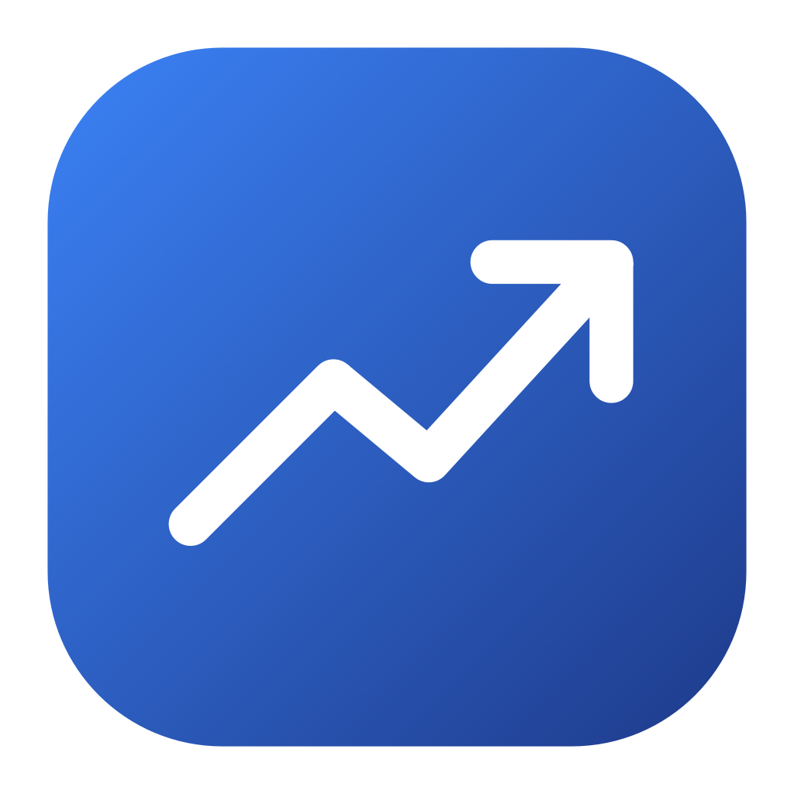
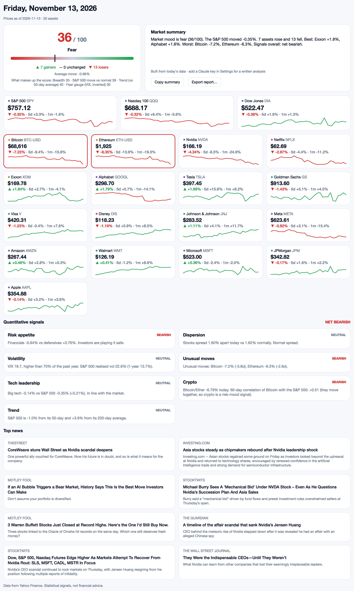

<p align="center">
  
</p>

<h1 align="center">Market Pulse</h1>

<p align="center">
  <b>What happened in the markets today, in one screen.</b><br>
  A desktop dashboard with 20 live markets, a fear–greed score, seven quantitative signals, the top news and a plain-language summary.
</p>

<p align="center">
  
  
  
  
  
</p>

<p align="center"></p>

## Features

- **20 markets in one click:** the S&P 500, Nasdaq 100, Dow, Bitcoin, Ether, big tech, banks, energy, consumer and defensive stocks. Each shows its day, 5-day and 1-month move and a 30-day sparkline.
- **Fear–greed score (0–100)** with its parts shown: breadth, the S&P 500's move compared with a normal day, trend vs the 50-day average, and the VIX against its last year.
- **Seven quantitative signals**, each measured against that asset's own history instead of fixed thresholds:
  - risk appetite (financials vs defensives)
  - cross-sectional dispersion
  - volatility (VIX percentile, realised vol)
  - unusual moves (|z| ≥ 2)
  - tech leadership
  - crypto (with its 60-day correlation to stocks)
  - trend (50/200-day averages)
- **Unusual moves are outlined.** A tile gets a colored border when the move is more than two standard deviations from normal.
- **Top news** from Reuters, the WSJ, CNBC and others through Yahoo Finance. Click a headline to open it.
- **Summary in English or Spanish:**
  - Without a key, the summary is built from the numbers.
  - With a Claude API key (optional, kept in your system keychain), Claude writes a three-paragraph analysis using only that day's data and headlines.
- **Presentation mode** (full screen, larger text) for a morning meeting. Copy or export the day as a Markdown report.
- **No account and no key needed** for prices or news.

## Install

**Download:** the latest Mac and Windows builds are in [Releases](../../releases).

> On macOS the app isn't notarized yet. The first time, right-click it and choose **Open**.

**From source:**

```bash
git clone https://github.com/ianjacobo2009-hub/marketpulse.git
cd marketpulse
python3 -m venv .venv && source .venv/bin/activate
pip install -r requirements.txt
python -m marketpulse
```

Optional AI summary: open **⚙ Settings** and paste a Claude API key, or set `ANTHROPIC_API_KEY`. The app calls `claude-opus-5-5` at low effort, with automatic fallback if a request is declined. Without a key, everything else works the same.

## How the score and signals work

| | Formula |
|---|---|
| Daily move z-score | `ln(Pₜ/Pₜ₋₁) / σ₆₀` where σ₆₀ is that asset's own 60-day daily volatility |
| Breadth | gainers ÷ (gainers + losers); moves under ±0.05% count as unchanged |
| Sentiment | average of breadth, a logistic of the S&P 500 z-score, trend vs the 50-day average, and 100 × (1 − VIX percentile) |
| Dispersion | cross-sectional standard deviation of stock returns today vs its 60-day average |
| Crypto link | 60-day correlation of Bitcoin and S&P 500 daily returns |

Run the tests with `pip install pytest && python -m pytest -q`. They check that the counts add up with no duplicates, the sentiment stays in range, a crash is flagged as an outlier, and both summary languages work.

## From prototype to software

Market Pulse started as a web prototype. This desktop version is a full rewrite that fixes what the prototype got wrong:

- A raw "Tagline:" label showed on the page.
- Assets that all moved were counted as "unchanged".
- The S&P 500 and the Dow were listed twice.
- A −6% crypto day was described as "low crypto volatility".
- A cross-sectional spread was presented as "annualized volatility".

All counts and signals are now computed from a year of daily data.

## Project layout

```
marketpulse/
  engine.py    prices, breadth, sentiment, the seven signals, news
  summary.py   Claude summary (optional key in the system keychain) and the built-in summary
  app.py       the desktop interface (PySide6), ES/EN
tests/         engine tests on synthetic data
marketpulse.spec  PyInstaller build (Mac .app / Windows .exe)
```

## Disclaimer

Data from Yahoo Finance; prices can be delayed. Statistical signals for information only. Not financial advice.

---

Built by **Ian** · [Blue Peak AI & Finance Solutions](https://github.com/ianjacobo2009-hub)
